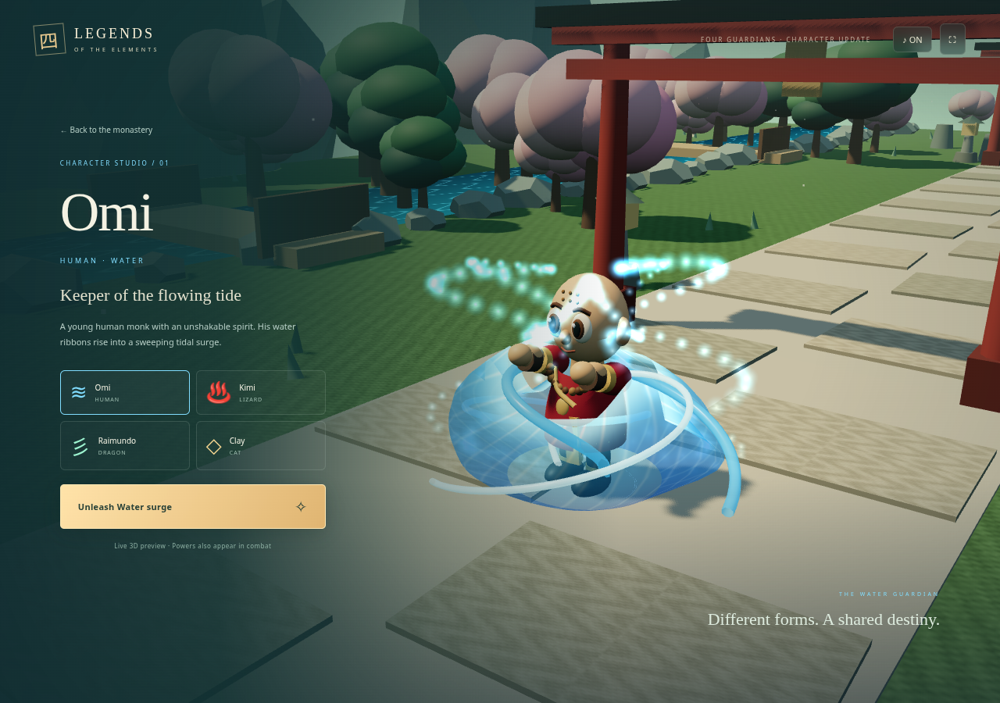

# Legends of the Elements + Lumen Drift

A browser game collection built with React, TypeScript, Vite, and Three.js / Canvas. The default page is **Legends of the Elements**, a playable, stylized 3D fan adventure inspired by Xiaolin Showdown. **Lumen Drift** remains available at `arcade.html`.

## Character and power update

The team now has four distinct 3D forms: **Omi (human)**, **Kimi (lizard)**, **Raimundo (dragon)**, and **Clay (cat)**. Models have articulated limbs, expressive eyes, detailed clothing, and species-specific tails, horns, ears, and animated wings. On the title screen, choose **Meet the guardians & preview powers** to inspect each character close up and trigger a live effect without combat.

Power visuals are also used in battles: Omi produces an expanding water sheet, curling streams and foam spray; Kimi creates animated flame plumes and embers; Raimundo creates rising wind helices and healing motes; Clay raises a ring of stone pillars and a shield dome. The landscape has richer lighting, textured ground, rounded foliage, and animated river water. These are stylized procedural 3D models, not photorealistic or imported studio character assets.



## Play the 3D adventure

Lead Omi and AI companions Kimi, Raimundo, and Clay through three chapters:

1. **The Jade Awakening** — young trainees defend the monastery and face the Iron Warden.
2. **Guardians of the Ember** — the team becomes adult guardians with increased health and power, and faces the Ash Sentinel.
3. **The Last Showdown** — elemental masters confront the Eclipse Sovereign.

Defeat every raider and guardian, collect healing crystals, and enter the glowing spirit gate at the **north end of the stone path**. Omi must survive; stand near a fallen AI companion for three seconds to revive them. Red floor rings warn of incoming attacks. Bosses attack faster below half health.

### Controls

- **WASD / arrows**: movement relative to the camera.
- **Hold J / Strike button**: attack the closest enemy in range.
- **E / Water surge**: area damage, freeze, and self-heal; cooldown improves with mastery.
- **Space / Dodge**: burst movement with brief invulnerability.
- **U / Upgrade team / hero card**: pause and manage upgrades.
- **1 / 2 / 3**: balanced, assault, or guard tactic.
- **P / Escape**: pause / resume. Losing browser focus also pauses.
- **Mobile**: left virtual stick to move; right-hand Strike, Water surge, and Dodge buttons.
- Top-right sound and fullscreen controls are available where supported.

### Team strategy

- **Omi / water**: freezes enemies and heals himself. Frozen enemies cannot attack or move.
- **Kimi / fire**: area attacks; deals 35% bonus damage against water-frozen enemies.
- **Raimundo / wind**: area healing bursts; mastery also adds a passive healing breeze.
- **Clay / earth**: nearby damage protection and temporary team shielding.

Spend spirit shards on damage, health, or role mastery for any teammate. Shards are awarded for defeats and restored relics. Each upgrade costs more than the last and is capped at four levels. Assault increases companion damage and pursuit range; Guard strengthens Clay's protection and keeps the team closer. Upgrades carry across all chapters of the current run. Beginning a new journey or refreshing resets campaign progress; there is no campaign save or multiplayer backend in this version.

## Hosting and updates

If your existing Netlify project is linked to another repository or was deployed manually, pushing to Games will not update that project. You can deploy without local developer tools: download the prebuilt [website ZIP](https://github.com/yamehta93-creator/Games/raw/refs/heads/main/release/legends-of-the-elements-web.zip), extract it with your device's built-in archive support, open your Netlify project's **Deploys** page, and use its manual deployment upload area to upload the extracted folder containing `index.html`. This is an alternative to linking `yamehta93-creator/Games`, branch `main`, build `npm run build`, publish `dist`.


The source repository is https://github.com/yamehta93-creator/Games . If Netlify is connected to its `main` branch, pushing changes triggers deployment to your existing site address. Netlify must finish its build before refreshing shows the new version. This repository cannot determine the URL of your connected Netlify project.

- **Netlify**: build `npm run build`, publish `dist`; `netlify.toml` is included.
- **Vercel**: import the repository, select Vite, build `npm run build`, output `dist`; `vercel.json` is included.
- **GitHub Pages**: prebuilt files are committed in `docs`. Configure Pages to deploy `main` → `/docs`. Rebuild and refresh `docs` before pushing future releases.
- The 3D adventure is at the site root; the original arcade game is at `/arcade.html` (or `/Games/arcade.html` on GitHub Pages).
- All visual models/scenery are original procedural meshes; sound is synthesized locally. The 3D adventure has no external asset/CDN requests and requires WebGL 2, supported by current Chrome, Edge, Firefox, and Safari. On devices without WebGL, the error screen links to the Canvas arcade game.
- A public game link can be shared directly. Source privacy is separate from website accessibility.

This is a compact three-chapter single-player campaign, not a commercial-scale open-world game. It uses deterministic companion behavior, not an external AI service. The cartoon names and inspiration are referenced as a fan project; artwork, models, villains, and level layouts are original. This is an unofficial fan prototype, not affiliated with the cartoon’s creators.

## Cloud development

Use the existing isolated checkout at `/workspace/Games`; no separate Git worktree is needed.

```
npm ci
npm run dev
npm test
npm run build
npm run preview
```

The Vite build emits both game entry points. `npm test` exercises the arcade and adventure systems, including team upgrades, AI attacks, invulnerability, revivals, chapter transitions, and final victory. Browser checks require system Chromium at `/usr/bin/chromium` and a running dev server:

```
npm run test:adventure
node tests/characters-browser.mjs
npm run test:browser
```

Screenshots are written to `/tmp`. Three.js visuals use real WebGL rendering; the test browser enables software rendering for GPU-less cloud machines. No credentials, backend service, or paid AI API is required.
